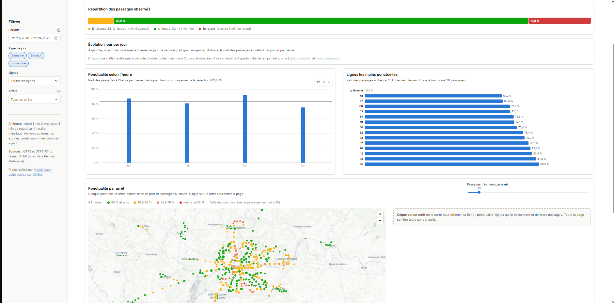
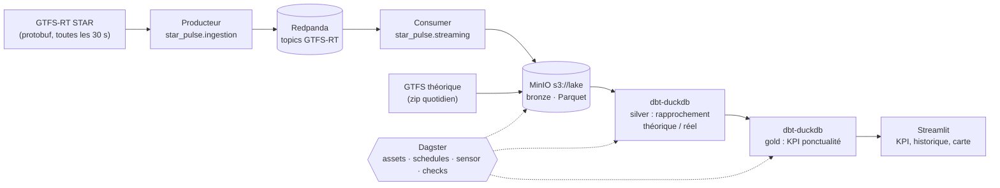

# STAR Pulse

[](https://github.com/TLxFroSt/star-pulse/actions/workflows/ci.yml)


**Les bus de Rennes sont-ils à l'heure ?** STAR Pulse collecte en continu les flux
temps réel GTFS-RT du réseau STAR, les confronte aux horaires théoriques GTFS et
mesure la ponctualité par ligne, par arrêt et par heure, jusqu'à un dashboard.

C'est un projet de data engineering complet et reproductible : streaming
(Redpanda), lakehouse sur stockage objet (MinIO, Parquet bronze / silver / gold),
transformations testées (dbt + DuckDB), orchestration (Dagster), CI. Tout tourne en
local avec Docker Compose, à coût zéro, sur des données open data sans
authentification.



## En chiffres

Sur une journée réelle collectée en novembre 2026 (11 064 passages observés) :

| À l'heure | En retard | En avance | Retard médian | Retard p90 |
|---|---|---|---|---|
| **78,2 %** | 16,1 % | 5,7 % | +44 s | +3 min 54 s |

« À l'heure » = entre 1 min d'avance et 3 min de retard sur l'horaire théorique
(définitions plus bas). Ces chiffres couvrent une seule journée : ils donnent un
ordre de grandeur, pas une tendance.

## Architecture



| Couche | Outil | Contenu |
|---|---|---|
| Bus de messages | Redpanda (API Kafka) + Console | une entité GTFS-RT par message, clé = course ou véhicule |
| Bronze | MinIO (S3) + Parquet | GTFS par version de contenu ; temps réel brut partitionné `date=/hour=` |
| Silver | dbt + DuckDB | chaque passage observé rattaché à son horaire théorique, retard en secondes |
| Gold | dbt + DuckDB | table de faits au grain passage, KPI par ligne / heure / arrêt, dimensions |
| Orchestration | Dagster | ingestion quotidienne, `dbt build` toutes les 15 min, sensor, asset checks |
| Restitution | Streamlit + pydeck | KPI, historique, classement des lignes, carte cliquable |

## Choix techniques

Chaque décision est expliquée dans un ADR ([index](docs/adr/README.md)) :

- **Redpanda, MinIO, DuckDB, Dagster, uv** : une stack locale gratuite, aux API
  standard (Kafka, S3), transposable dans le cloud. [ADR 0001](docs/adr/0001-stack-locale.md)
- **Bronze GTFS idempotent** : une version = un hash du contenu, pas du zip (STAR le
  regénère chaque nuit même sans changement). [ADR 0002](docs/adr/0002-bronze-gtfs-theorique.md)
- **Une entité par message, dédoublonnée** : seules les entités modifiées sont
  publiées ; les doublons restants s'éliminent en aval sur une clé stable.
  [ADR 0003](docs/adr/0003-messages-gtfs-rt.md)
- **Bronze at-least-once** : offsets commités après écriture, noms de fichiers
  déterministes, partitionnement sur le temps de l'événement.
  [ADR 0004](docs/adr/0004-bronze-gtfs-rt.md)
- **Rapprochement théorique / réel** : le flux STAR ne donne ni le jour de service ni
  l'heure de passage effective ; le silver reconstruit les deux et écarte les
  prévisions inexploitables. [ADR 0005](docs/adr/0005-silver-rapprochement-theorique-reel.md)
- **KPI aux définitions explicites**, additifs par compteurs.
  [ADR 0006](docs/adr/0006-kpi-ponctualite.md)
- **Dagster en software-defined assets**, chaque modèle et test dbt visible dans le
  lignage ; le streaming reste hors de l'orchestrateur.
  [ADR 0007](docs/adr/0007-orchestration-dagster.md)
- **CI et jeu de démonstration** : un réseau fictif et un temps réel simulé font
  tourner tout le pipeline en CI, sans dépendre des flux STAR.
  [ADR 0008](docs/adr/0008-ci-et-jeu-de-demo.md)
- **Dashboard calculé au grain passage** : chiffres exacts pour n'importe quel filtre,
  arrêts regroupés par nom, carte cliquable. [ADR 0009](docs/adr/0009-dashboard-streamlit.md)

## Démarrage rapide

Prérequis : [uv](https://docs.astral.sh/uv/), Docker (avec Compose v2) et `make`.

```bash
git clone https://github.com/TLxFroSt/star-pulse.git && cd star-pulse
cp .env.example .env        # valeurs locales par défaut, aucun secret réel
make install                # Python 3.12 + dépendances + hooks pre-commit
make up                     # Redpanda, Redpanda Console, MinIO + bucket "lake"
```

### Voir le dashboard tout de suite (démo)

```bash
make demo                   # réseau fictif + une semaine de temps réel simulé, puis dbt build
make demo-dashboard         # http://localhost:8501
```

La démo s'écrit dans un bucket séparé (`demo`) : elle ne se mélange jamais aux
données réelles. Ses chiffres sont synthétiques.

### Collecter les données réelles

```bash
make ingest-gtfs            # GTFS théorique STAR -> bronze
make produce-rt             # terminal 1 : flux GTFS-RT -> Redpanda (Ctrl+C pour arrêter)
make consume-rt             # terminal 2 : Redpanda -> Parquet bronze sur MinIO
make dagster                # terminal 3 : http://localhost:3000, planifie ingestion et dbt
make dashboard              # http://localhost:8501
```

Sans Dagster, `make dbt-build` construit silver et gold à la demande. Les KPI
apparaissent après quelques minutes de collecte ; l'historique se remplit au fil des
jours où le producteur et le consumer tournent.

| Service | URL |
|---|---|
| Dashboard | http://localhost:8501 |
| Dagster | http://localhost:3000 |
| Redpanda Console | http://localhost:8080 |
| MinIO Console | http://localhost:9001 |
| Documentation dbt (`make dbt-docs`) | http://localhost:8081 |

## Définition des KPI

| Indicateur | Définition |
|---|---|
| Passage | un arrêt desservi par une course, rattaché à son horaire théorique |
| À l'heure | retard entre **−60 s et +180 s**, bornes incluses |
| En avance | plus d'1 min d'avance (un bus en avance fait rater le bus) |
| En retard | plus de 3 min de retard |
| Supprimé | arrêt marqué `SKIPPED` dans le temps réel, compté à part |
| % à l'heure | passages à l'heure / passages observés (supprimés exclus du dénominateur) |
| Retard médian, p90 | centiles exacts du retard en secondes |

Les arrivées au terminus sont exclues des KPI : les horaires y intègrent une marge et
les bus y arrivent souvent en avance. L'heure et le jour sont ceux de l'horaire
théorique, en heure de Paris, au sens du jour de service GTFS. Détails dans
[l'ADR 0006](docs/adr/0006-kpi-ponctualite.md).

## Qualité des données

- **À l'ingestion** : validation du zip GTFS (fichiers obligatoires), version
  identifiée par le contenu, messages GTFS-RT illisibles mis de côté dans
  `bronze/gtfs_rt/_rejected/` au lieu d'être perdus.
- **Dédoublonnage** sur `(entity_key, entity_version)` : la livraison at-least-once
  ne crée pas de double compte.
- **Filtres du silver** : courses figées (mise à jour vieille de plus de 30 min) et
  prévisions « plates » (tous les arrêts à la même heure) écartées ; seuls les
  passages révolus sont gardés.
- **Tests dbt** : unicité des grains, non-nullité, relations vers les dimensions,
  valeurs acceptées, pourcentages dans [0, 1], cohérence des totaux KPI avec la
  table de faits, un unit test sur les bornes de ponctualité, et une alerte si plus
  de 5 % des passages temps réel ne trouvent pas leur horaire théorique.
- **Asset checks Dagster** : fraîcheur du bronze temps réel (< 10 min) et volume
  minimal du GTFS.
- **CI** à chaque push : lint, typage strict, 107 tests Python (unitaires et
  intégration contre Redpanda et MinIO) et `dbt build` complet sur le jeu de démo.

## Commandes

| Commande | Effet |
|---|---|
| `make up` / `make down` | démarre / arrête l'infra Docker (volumes conservés) |
| `make lint` | `ruff check` + `ruff format --check` + `mypy --strict` |
| `make fmt` | formatage automatique |
| `make test` | tests unitaires |
| `make test-integration` | tests d'intégration contre Redpanda et MinIO (après `make up`) |
| `make demo` | jeu de démo en bronze (bucket `demo`) puis `dbt build` |
| `make demo-dashboard` | dashboard sur les données de démo |
| `make ingest-gtfs` | ingère le GTFS théorique STAR dans `s3://lake/bronze/gtfs_static/` |
| `make produce-rt` | interroge les flux GTFS-RT toutes les 30 s et publie sur Redpanda |
| `make consume-rt` | consomme Redpanda et écrit le Parquet bronze (`s3://lake/bronze/gtfs_rt/`) |
| `make dbt-build` | construit et teste silver et gold (`s3://lake/silver/`, `s3://lake/gold/`) |
| `make dbt-freshness` | alerte si le bronze temps réel a plus de 10 min |
| `make dbt-docs` | documentation et lignage dbt sur http://localhost:8081 |
| `make dagster` | Dagster sur http://localhost:3000 (schedules et sensor actifs) |
| `make dashboard` | dashboard sur http://localhost:8501 |

## Structure

```
src/star_pulse/   code Python : config, ingestion, streaming, transform, orchestration, dashboard, demo
dbt/              projet dbt : staging, intermediate (silver), gold, tests
orchestration/    instance Dagster locale (dagster.yaml)
dashboard/        point d'entrée Streamlit (app.py)
docs/adr/         Architecture Decision Records
tests/            unit/, integration/, fixtures/ (extrait GTFS STAR, réseau fictif de démo)
.github/          workflow de CI
```

## Limites

- **Pas d'archive du temps réel chez STAR** : l'historique ne couvre que les périodes
  où la collecte a tourné. Une interruption est un trou définitif.
- **L'heure observée est une prévision** : le flux ne donne que les arrêts à venir ;
  la dernière prévision émise avant le passage sert de mesure. Son avance sur le
  passage est conservée (colonne `prediction_lead_s`) pour juger de sa fiabilité.
- **Écarts d'horaires suspects** : une ligne peut apparaître très en retard si le
  GTFS et le temps réel sont décalés (cas observé sur La Navette). Ce n'est pas
  corrigé automatiquement.
- **Une seule machine** : DuckDB n'accepte qu'un écrivain, d'où une seule exécution
  dbt à la fois ; le volume reste celui d'un réseau de bus urbain.

## Suite possible

- Déploiement Azure avec Terraform : ADLS Gen2 à la place de MinIO, conteneurs pour
  le producteur, le consumer et le dashboard (même code, endpoints différents).
- Croisement avec la disponibilité des vélos en libre-service : les jours de retard
  font-ils monter l'usage du vélo ?
- Partitionnement de la table de faits par jour quand l'historique atteindra
  plusieurs mois, et alerte quand une ligne décroche.

## Sources de données

Open data du réseau STAR (Rennes Métropole), via
[data.explore.star.fr](https://data.explore.star.fr) et
[transport.data.gouv.fr](https://transport.data.gouv.fr) : horaires théoriques GTFS
et flux GTFS-RT *trip updates*, *vehicle positions* et *alerts*. La collecte respecte
les sources : un appel toutes les 30 s au plus par flux, User-Agent explicite,
retries avec backoff.

## Feuille de route

- [x] **Étape 0** — Squelette : arborescence, uv, Docker Compose, Makefile, pre-commit
- [x] **Étape 1** — Ingestion GTFS théorique → bronze (checksum de contenu, idempotence)
- [x] **Étape 2** — Producteur GTFS-RT → Redpanda (déduplication, producteur idempotent)
- [x] **Étape 3** — Consumer Redpanda → Parquet sur MinIO (at-least-once, partitions date/heure)
- [x] **Étape 4** — dbt silver : rapprochement théorique / réel
- [x] **Étape 5** — dbt gold : KPI de ponctualité
- [x] **Étape 6** — Orchestration Dagster
- [x] **Étape 7** — Dashboard Streamlit
- [x] **Étape 8** — CI GitHub Actions, jeu de démo, README, ADR
- [ ] **Bonus** — Déploiement Azure (Terraform)

## Auteur

Projet conçu et développé par **Mehdi Mami** ([@TLxFroSt](https://github.com/TLxFroSt)).
