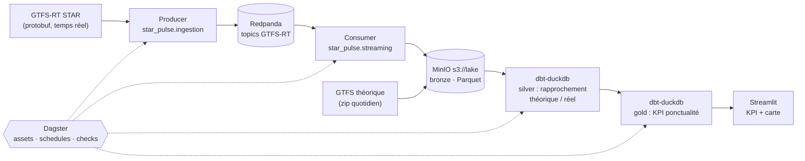

# STAR Pulse

**Les bus de Rennes sont-ils à l'heure ?** STAR Pulse est un pipeline de data engineering
qui ingère en continu les flux temps réel GTFS-RT du réseau STAR, les confronte aux horaires
théoriques GTFS et calcule des KPI de ponctualité par ligne, arrêt et heure, exposés dans un
dashboard.

Tout tourne en local avec Docker Compose, à coût zéro, sur des données open data sans
authentification.

> Statut : **Étape 0 — squelette du projet.** Voir la [feuille de route](#feuille-de-route).

## Architecture



| Couche | Outil | Rôle |
|---|---|---|
| Bus de messages | Redpanda (API Kafka) + Console | découple la collecte temps réel du stockage |
| Stockage | MinIO (S3) + Parquet `date=/hour=` | lakehouse bronze / silver / gold |
| Transformations | DuckDB + dbt-duckdb | modèles `stg_*`, `int_*`, `fct_*` / `dim_*` testés |
| Orchestration | Dagster | assets, schedules, sensors, asset checks |
| Restitution | Streamlit | KPI et carte des retards |

Les choix de stack sont expliqués dans [`docs/adr/`](docs/adr/).

## Démarrage rapide

Prérequis : [uv](https://docs.astral.sh/uv/), Docker (avec Compose v2) et `make`.

```bash
cp .env.example .env        # puis adapter si besoin
make install                # dépendances Python 3.12 + hooks pre-commit
make up                     # Redpanda, Redpanda Console, MinIO + bucket "lake"
make lint && make test
```

| Service | URL |
|---|---|
| Redpanda (Kafka) | `localhost:19092` |
| Redpanda Console | http://localhost:8080 |
| MinIO API S3 | http://localhost:9000 |
| MinIO Console | http://localhost:9001 |

`make down` arrête l'infra (les volumes sont conservés).

## Commandes

| Commande | Effet |
|---|---|
| `make up` / `make down` | démarre / arrête l'infra Docker |
| `make lint` | `ruff check` + `ruff format --check` + `mypy --strict` |
| `make fmt` | formatage automatique |
| `make test` | `pytest` |

## Structure

```
src/star_pulse/   code Python (config, ingestion, streaming, common)
dbt/              projet dbt (bronze / silver / gold)
orchestration/    définitions Dagster
dashboard/        app Streamlit
infra/terraform/  bonus : déploiement Azure
docs/adr/         Architecture Decision Records
tests/            unit/, integration/, fixtures/
```

## Sources de données

Open data du réseau STAR (Rennes Métropole), via transport.data.gouv.fr et data.gouv.fr :
horaires théoriques GTFS, flux GTFS-RT *trip updates*, *vehicle positions* et *alerts*.
La collecte respecte les sources : polling ≥ 30 s, User-Agent explicite, retries avec backoff.

## Feuille de route

- [x] **Étape 0** — Squelette : arborescence, uv, Docker Compose, Makefile, pre-commit, smoke test
- [ ] **Étape 1** — Ingestion GTFS théorique → bronze
- [ ] **Étape 2** — Producteur GTFS-RT → Redpanda
- [ ] **Étape 3** — Consumer Redpanda → Parquet sur MinIO
- [ ] **Étape 4** — dbt silver : rapprochement théorique / réel
- [ ] **Étape 5** — dbt gold : KPI de ponctualité
- [ ] **Étape 6** — Orchestration Dagster
- [ ] **Étape 7** — Dashboard Streamlit
- [ ] **Étape 8** — CI GitHub Actions, README complet, ADR
